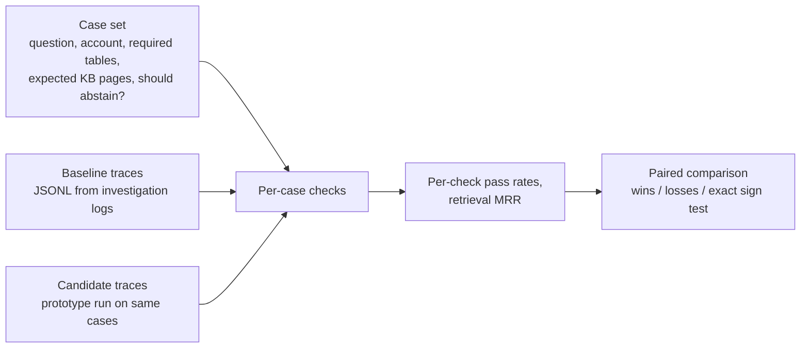

> **Proprietary - All Rights Reserved.** Licensed to Sandeep Grover. No reuse, copying, modification, or distribution without prior written permission. See LICENSE.

# bi-agent-eval-harness

A small, runnable sample of a repeatable evaluation for a business-intelligence agent: an
assistant that investigates a client account by querying a data warehouse (for example
BigQuery) and searching a company knowledge base (for example Slite), then either recommends
an action or says the evidence is not enough.

The harness does not call any model. It scores **recorded investigation traces** (the tool
calls an agent made, what each returned, and its final answer) against a **case set** with
known expectations, so two versions of an agent (the current system and a prototype) can be
compared on the same cases.

All accounts, tables, numbers and knowledge-base pages in `data/` are invented. No client data.



## What is checked per case

| Check | Question it answers | Not applicable when |
|---|---|---|
| `required_tables` | Did the agent pull every data source the question needs? | the case expects abstention |
| `tool_budget` | Did it stay within the agreed number of tool calls (cost, loops)? | no budget set |
| `read_only_sql` | Were all warehouse queries read-only? | no SQL ran |
| `account_isolation` | Did every query filter on this account and on no other client's account? | no SQL ran |
| `date_bounded_sql` | Did every query bound the date range (period and scanned bytes)? | no SQL ran |
| `retrieval_hit@5` | Was an expected knowledge page in the first search's top 5? | no expected pages |
| `citations_exist` | Does every citation point at a result the agent actually received? | the agent abstained |
| `numbers_grounded` | Does every number in the recommendation appear in a cited result (raw, rounded, or as a percentage)? | the agent abstained |
| `abstention_correct` | Did it recommend only when evidence supported it, and abstain otherwise? | never |

A case passes when every applicable check passes. A missing trace counts as a failed case.

## Run

```bash
python -m pip install -r requirements.txt   # pytest only; the harness is standard library
python main.py                               # scores both variants, writes results.json
python -m pytest -q                          # 17 tests
python data/make_fixtures.py                 # regenerate the invented fixtures
```

Output on the invented fixtures (8 cases):

```
baseline: 2/8 cases pass every applicable check
candidate: 7/8 cases pass every applicable check
paired: wins ['C01', 'C02', 'C04', 'C05', 'C06', 'C07'] losses ['C08'] ties 1 sign-test p=0.125
verdict: no reliable difference on this case set; add representative cases before deciding
```

The candidate fixes six cases and breaks one (it recommends on five days of data after a
tracking change). With only eight cases, six wins against one loss is not a reliable
difference (exact two-sided sign test p = 0.125). That is the point of the paired design: a
prototype should be adopted on evidence from enough representative accounts, not on a few
good-looking examples.

## Trace format

One JSON object per line:

```json
{"case_id": "C01",
 "steps": [{"tool": "warehouse.query", "args": {"sql": "SELECT ..."}, "result_id": "r1", "result": {"rows": [...]}},
           {"tool": "knowledge.search", "args": {"query": "..."}, "result_id": "r2", "result": {"doc_ids": ["kb-..."]}}],
 "final": {"abstained": false, "recommendation": "...", "citations": ["r1", "r2"]}}
```

Tool-call logs from an OpenAI function-calling loop map onto this directly: each tool call
becomes a step, each tool output its `result`, and the final message its `final` block.

## Limits

- Text checks are deliberately simple (regular expressions over SQL, number matching). They
  catch common failures cheaply; they do not judge whether a recommendation is commercially
  sensible. That judgement comes from experienced operators rating the same cases, which can
  be added as another column and compared with these automatic checks.
- The fixtures are invented and tiny. They exercise the code; they say nothing about any real
  system.
